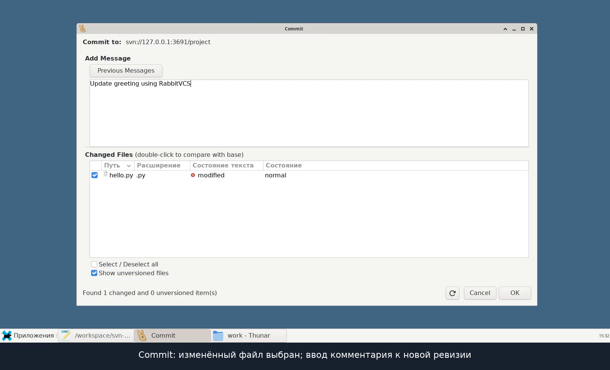

# Smart Order · Liquid Glass v11

- [Скачать SmartOrder v11 — ZIP исходников](https://github.com/yaebalprincess/yaebal/archive/refs/heads/smartorder-liquid-glass-v11.zip)
- [Запуск, сборка и изменения v11](https://github.com/yaebalprincess/yaebal/tree/smartorder-liquid-glass-v11)
- [Проверки и снимки экранов](https://github.com/yaebalprincess/yaebal/blob/smartorder-liquid-glass-v11/LIQUID_GLASS_V11_QA.md)

Книга открывает «Обучение: как работать с нарядами?» с кнопкой «Начать!». Нумерованные подсказки с рябью ведут мастера через реальные нажатия и ввод данных до истории и разрешённых функций администрирования. Справка непрозрачная, значки векторные, календарь редактора общий с главным меню. Выгрузка и печать остаются в главном списке. Меню цехов открывается внутри окна; добавлена защита первого кадра и доступности заголовка при перетаскивании.

Основной прогон: 124 проверки прошли. В ZIP исходники и скрипты сборки, готового Windows EXE нет. Нативные Windows Snap и перетаскивание к панели задач в среде Linux не запускались.

---

# Smart Order · Liquid Glass v10

- [Скачать SmartOrder v10 — ZIP исходников](https://github.com/yaebalprincess/yaebal/archive/refs/heads/smartorder-liquid-glass-v10.zip)
- [Запуск, сборка и изменения v10](https://github.com/yaebalprincess/yaebal/tree/smartorder-liquid-glass-v10)
- [Проверки и примеры экранов](https://github.com/yaebalprincess/yaebal/blob/smartorder-liquid-glass-v10/LIQUID_GLASS_V10_QA.md)

Таблица наряда с переносом работ и сохранением ширины столбцов, подробная история изменений, руководство по F1 и обучение мастера. Кнопка выгрузки разделена на Excel и прямую печать. В справочниках под датами создания и изменения отображаются авторы. Круговая анимация темы отключена.

В ZIP исходники, обновлённая инструкция и скрипты сборки Windows; готового EXE нет. Печатный PDF проверен, штатный диалог Windows и физический принтер в среде Linux не запускались.

---

# Smart Order · Liquid Glass v9

- [Скачать SmartOrder v9 — ZIP исходников](https://github.com/yaebalprincess/yaebal/archive/refs/heads/smartorder-liquid-glass-v9.zip)
- [Запуск, сборка и изменения v9](https://github.com/yaebalprincess/yaebal/tree/smartorder-liquid-glass-v9)

Общий редактор наряда с меткой режима, уведомления о черновиках, системный выбор файла Windows и затухание окна загрузки цеха. В аналитике обновлены календарь, подпись диаграммы и методика. Руководство открывается локальной страницей с четырьмя снимками учебной базы. Полноэкранный режим применяет размер окна один раз, темы переключаются напрямую.

В ZIP исходники, инструкция запуска и скрипты сборки Windows.

---

# Smart Order · Liquid Glass v8

- [Скачать SmartOrder v8 — ZIP исходников](https://github.com/yaebalprincess/yaebal/archive/refs/heads/smartorder-liquid-glass-v8.zip)
- [Исходники, запуск и изменения](https://github.com/yaebalprincess/yaebal/tree/smartorder-liquid-glass-v8)

Значок пустого списка нарядов по центру, затухающие подсказки полноэкранного и оконного режимов, плавные переходы между вкладками и круговое раскрытие темы. Кнопки справочников при первом открытии остаются внутри вкладок.

В ZIP исходники, инструкция запуска и скрипты сборки Windows.

---

# Smart Order · Liquid Glass v7

- [Скачать SmartOrder v7 — ZIP исходников](https://github.com/yaebalprincess/yaebal/archive/refs/heads/smartorder-liquid-glass-v7.zip)
- [Исходники, запуск и изменения](https://github.com/yaebalprincess/yaebal/tree/smartorder-liquid-glass-v7)
- [Руководство пользователя — PDF](https://github.com/yaebalprincess/yaebal/blob/smartorder-liquid-glass-v7/docs/SmartOrder_User_Guide_v7.pdf)
- [Проверки и ограничения](https://github.com/yaebalprincess/yaebal/blob/smartorder-liquid-glass-v7/LIQUID_GLASS_V7_QA.md)

Быстрый отклик тумблера темы, вкладки без обрезки при масштабе, стеклянные списки,
индивидуальные права пользователей, отложенная активация учётных записей,
восемь языков и перенос персонализации через JSON или общую базу.
Роль «Аналитик» заменена на «Экономист»; уведомления экономисту доступны.

Для новых прав и синхронизации обновите все клиенты общей базы до v7.
Архив содержит исходники и скрипты сборки, без готового Windows EXE.
Сохраните `resources` своей установки. Подробности запуска и проверки — в README архива.

---

# Smart Order · Liquid Glass v6

- [Скачать SmartOrder v6 — ZIP исходников](https://github.com/yaebalprincess/yaebal/archive/refs/heads/smartorder-liquid-glass-v6.zip)
- [Исходники, запуск и изменения](https://github.com/yaebalprincess/yaebal/tree/smartorder-liquid-glass-v6)
- [Руководство пользователя — PDF](https://github.com/yaebalprincess/yaebal/blob/smartorder-liquid-glass-v6/docs/SmartOrder_User_Guide_v6.pdf)
- [Проверки и ограничения](https://github.com/yaebalprincess/yaebal/blob/smartorder-liquid-glass-v6/LIQUID_GLASS_V6_QA.md)

Изменяемая ширина столбцов, подсказки пустых таблиц, три языка персонализации,
локальный масштаб вкладок и переключение цеха без пересоздания главного окна.
В аналитике масштаб отключён. Исправлены переключатель темы, кнопки сотрудников,
заголовок и флажки создания пользователя, колокольчик и нижний блок «О приложении».

Это исходники со скриптами сборки, без готового Windows EXE. Сохраните папку
`resources` своей установки. Пять фотографий цехов в архив не включены;
сопоставление имён файлов и поиск в `resources` уже реализованы. Подробности в README архива.

---

# Smart Order · Liquid Glass v5

Персонализация профиля в отдельной вкладке после аналитики, прежние окна входа и первого запуска, расписание тем, два варианта «О приложении» и исправления диалогов.

- [Скачать SmartOrder v5 — ZIP исходников](https://github.com/yaebalprincess/yaebal/archive/refs/heads/smartorder-liquid-glass-v5.zip)
- [Исходники и запуск](https://github.com/yaebalprincess/yaebal/tree/smartorder-liquid-glass-v5)
- [Руководство пользователя — PDF](https://github.com/yaebalprincess/yaebal/blob/smartorder-liquid-glass-v5/docs/SmartOrder_User_Guide_v5.pdf)
- [Проверки и ограничения](https://github.com/yaebalprincess/yaebal/blob/smartorder-liquid-glass-v5/LIQUID_GLASS_V5_QA.md)

Архив содержит только приложение, инструкцию и примеры экранов. Готового Windows EXE в нём нет. Для прежней GIF-анимации сохраните папку `resources` из установленной программы. Инструкция запуска и сборки находится внутри архива.

---

# Smart Order · Liquid Glass v4

Персонализация шрифтов и фона, единая шапка и масштаб во всех вкладках, живые прозрачные диалоги со скруглением и новая инструкция.

- [Скачать полный архив v4](./SmartOrder_LiquidGlass_v4_source.zip?raw=true)
- [Исходники, запуск и снимки экранов](./SmartOrder_LiquidGlass_v4/README.md)
- [Руководство пользователя — PDF](./SmartOrder_LiquidGlass_v4/docs/SmartOrder_User_Guide_v4.pdf)
- [57 успешных проверок и ограничения Windows](./SmartOrder_LiquidGlass_v4/LIQUID_GLASS_V4_QA.md)

Предпросмотр: `PREVIEW_LIQUID_GLASS.cmd` (Python 3.12 x64). Для рабочего запуска — `main.py` и прежняя общая база.
Изменения выложены исходниками; отрисовку на целевом Windows-ПК необходимо проверить.

---

# Smart Order · Liquid Glass v3

Единый стеклянный стиль главного экрана, редактора наряда, всех вкладок и вложенных окон.

- [Скачать полный архив исходников v3](./SmartOrder_LiquidGlass_v3_source.zip?raw=true)
- [Открыть исходники, инструкцию и снимки экранов](./SmartOrder_LiquidGlass_v3/README.md)
- [Проверки: 48 тестов прошли](./SmartOrder_LiquidGlass_v3/LIQUID_GLASS_V3_QA.md)

Запуск предпросмотра: распаковать архив и открыть `PREVIEW_LIQUID_GLASS.cmd` (Python 3.12 x64).
Для рабочего запуска — `main.py` и прежний путь к общей базе. Выложены исходники; Windows EXE не включён.

---

# SVN: сервер и графический клиент

[Скачать видео с графическим интерфейсом — MP4, 58 секунд](./svn-gui-demo.mp4?raw=true)

Запись настоящего рабочего стола Linux и графического клиента RabbitVCS 0.19, подключённого к серверу Apache Subversion 1.14.5 по протоколу `svn://`.

В ролике показаны установленные версии, конфигурация прав доступа сервера, браузер репозитория, Checkout, редактирование файла, Commit, получение изменений во второй рабочей копии через Update и просмотр истории ревизий. Действия выполняются в настоящих окнах программы; пояснения вынесены в подписи под записью экрана.

[Предыдущая демонстрация в терминале — MP4, 56 секунд](./svn-demo.mp4?raw=true)

Сервер доступен только на локальном интерфейсе. Используется отдельный учебный пользователь; пароль в видео не показывается.
