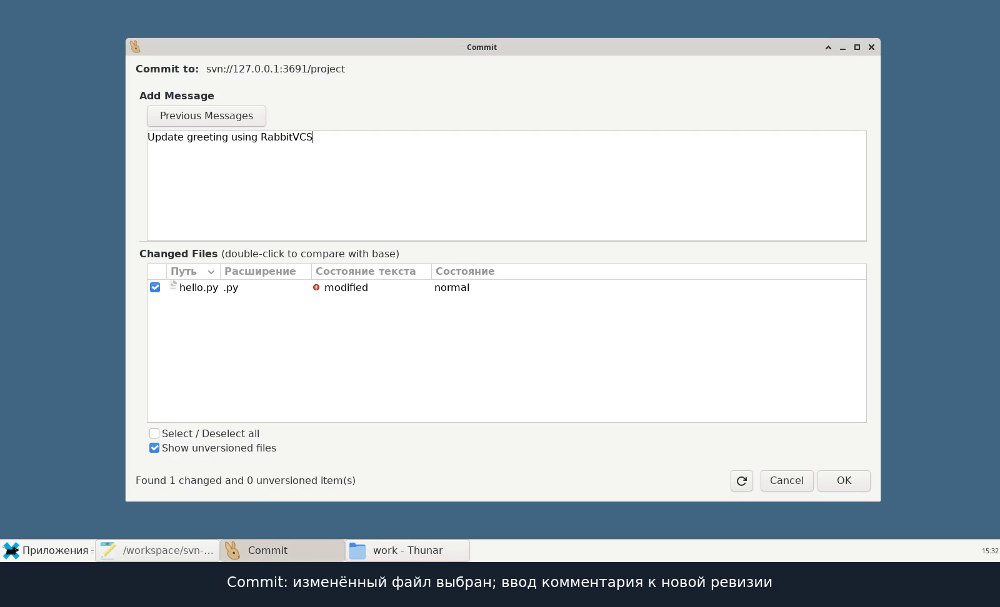

# SVN: сервер и графический клиент

[Скачать видео с графическим интерфейсом — MP4, 58 секунд](./svn-gui-demo.mp4?raw=true)

Запись настоящего рабочего стола Linux и графического клиента RabbitVCS 0.19, подключённого к серверу Apache Subversion 1.14.5 по протоколу `svn://`.

В ролике показаны установленные версии, конфигурация прав доступа сервера, браузер репозитория, Checkout, редактирование файла, Commit, получение изменений во второй рабочей копии через Update и просмотр истории ревизий. Действия выполняются в настоящих окнах программы; пояснения вынесены в подписи под записью экрана.

[Предыдущая демонстрация в терминале — MP4, 56 секунд](./svn-demo.mp4?raw=true)

Сервер доступен только на локальном интерфейсе. Используется отдельный учебный пользователь; пароль в видео не показывается.
