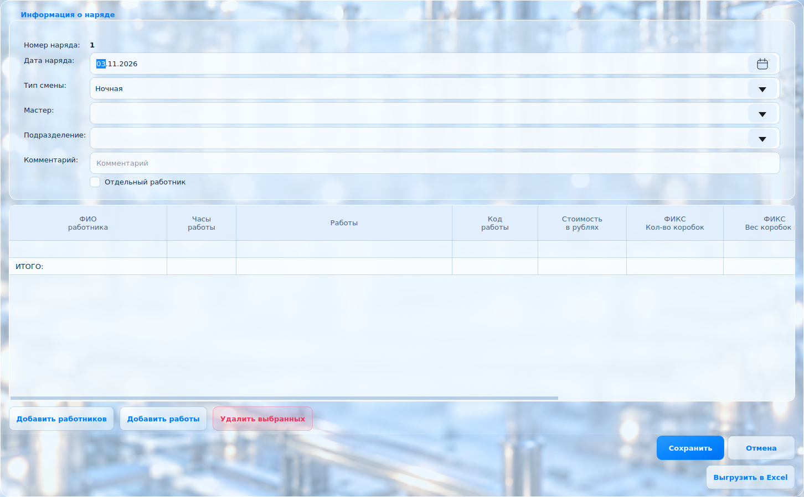
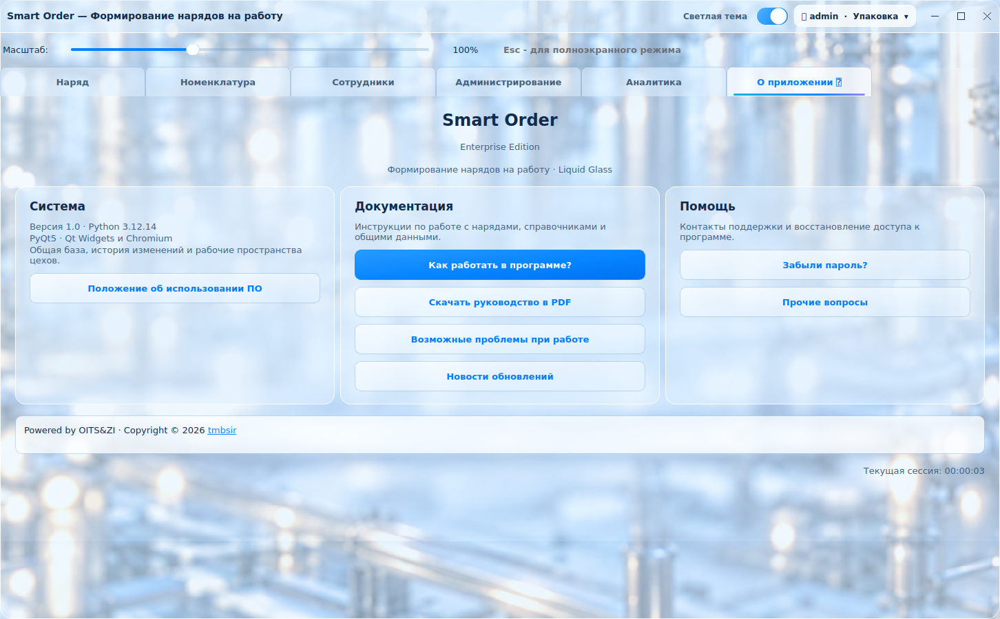
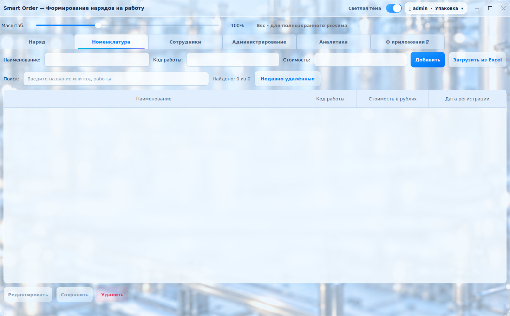
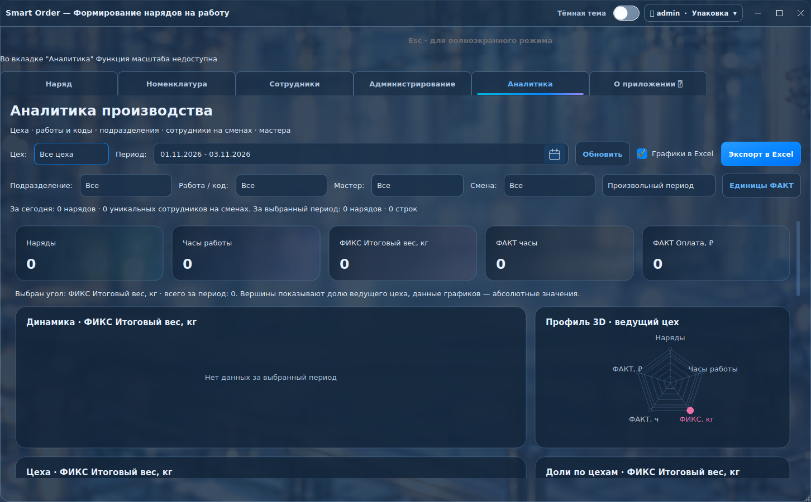

# Smart Order · Liquid Glass v3

Единое стеклянное оформление всего приложения на основе главного экрана v2.

- «Наряд»: сохранён исходный экран Chromium с его анимациями и фильтрами.
- «Создать наряд», редактирование, просмотр: общий фон, стеклянные поля и таблицы.
- Номенклатура, сотрудники, администрирование, аналитика и «О приложении»
  используют ту же палитру, поверхности, блики и переходы.
- Вложенные окна, списки, календари, новости и поддержка оформлены в том же стиле.
- Светлая/тёмная тема, масштаб, расчёты, права, блокировки, SQLite и Excel сохранены.

## Запуск

Для просмотра распакуйте архив и запустите **PREVIEW_LIQUID_GLASS.cmd**.
Требуется Python 3.12 x64. Предпросмотр использует отдельную временную базу.

Для обычной работы запускайте `main.py` с прежними настройками общей папки.

```powershell
py -3.12 -m pip install -r requirements.txt
py -3.12 main.py
```

Предпросмотр отдельного раздела:

```powershell
py -3.12 tools/preview_liquid_glass.py --tab about --screenshot about.png
py -3.12 tools/preview_liquid_glass.py --dialog create --screenshot create.png
```

Параметры `--tab`: orders, catalog, employees, admin, analytics, about.
Параметры `--dialog`: create, calendar, employees, works; `--theme dark`; `--zoom 150`.

- [Что изменилось](CHANGES_LIQUID_GLASS_V3.md)
- [Проверки и ограничения](LIQUID_GLASS_V3_QA.md)
- [Запуск и Windows-сборка](LIQUID_GLASS_RU.md)

## Примеры экранов






В комплект входят исходники. Готовый Windows EXE не включён.
Для сборки используйте `Build_SmartOrder.ps1` и оригинальную папку `resources`
с иконкой приложения. Схема рабочих баз и их содержимое оформлением не меняются.
