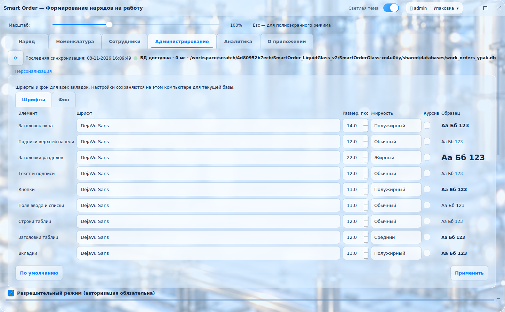
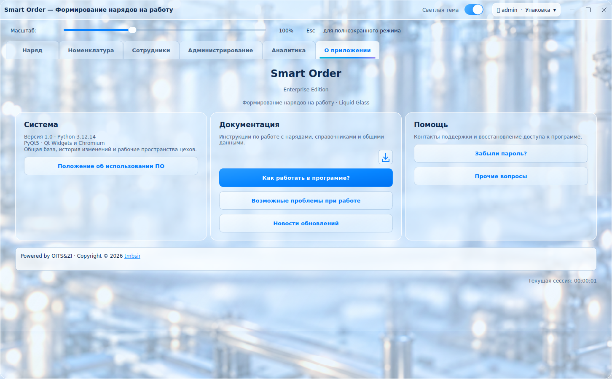
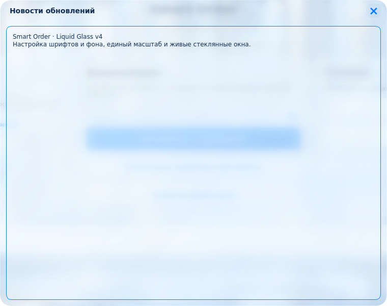
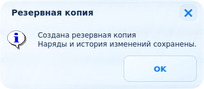

# Smart Order · Liquid Glass v4

Персонализация, единая шапка и масштаб, живые стеклянные диалоги.

- В «Администрирование → Персонализация» доступны все установленные шрифты:
  отдельные семейство, размер, жирность и курсив для девяти типов элементов.
- Там же можно выключить изображение фона или выбрать своё.
- Все вкладки используют одну верхнюю панель, навигацию и масштаб, включая аналитику.
- Диалоги, новости, резервные копии и выбор файлов имеют прозрачные скруглённые
  окна. Подложка обновляется от интерфейса под ними, размывается и преломляется по краям.
- Инструкция переписана под текущие наряды. Значок загрузки PDF находится справа
  над «Как работать в программе?».
- Данные, расчёты, права, блокировки и Excel используют прежние контроллеры.

## Запуск

Для просмотра распакуйте архив и запустите **PREVIEW_LIQUID_GLASS.cmd**.
Требуется Python 3.12 x64. Предпросмотр использует отдельную временную базу.

Для обычной работы запускайте `main.py` с прежними настройками общей папки.

```powershell
py -3.12 -m pip install -r requirements.txt
py -3.12 main.py
```

Предпросмотр отдельного раздела:

```powershell
py -3.12 tools/preview_liquid_glass.py --tab about --screenshot about.png
py -3.12 tools/preview_liquid_glass.py --dialog create --screenshot create.png
```

Параметры `--tab`: orders, catalog, employees, admin, analytics, about.
Параметры `--dialog`: create, calendar, employees, works, news, backup; `--theme dark`; `--zoom 150`.

- [Что изменилось](CHANGES_LIQUID_GLASS_V4.md)
- [Проверки и ограничения](LIQUID_GLASS_V4_QA.md)
- [Руководство пользователя в PDF](docs/SmartOrder_User_Guide_v4.pdf)
- [Запуск и Windows-сборка](LIQUID_GLASS_RU.md)

## Примеры экранов






В комплект входят исходники. Готовый Windows EXE не включён.
Для сборки используйте `Build_SmartOrder.ps1` и оригинальную папку `resources`
с иконкой приложения. Схема рабочих баз и их содержимое оформлением не меняются.

Нативная отрисовка и перемещение стеклянных окон на Windows требуют проверки
на целевом ПК. Результаты проверок Linux и ограничения описаны в отчёте выше.
